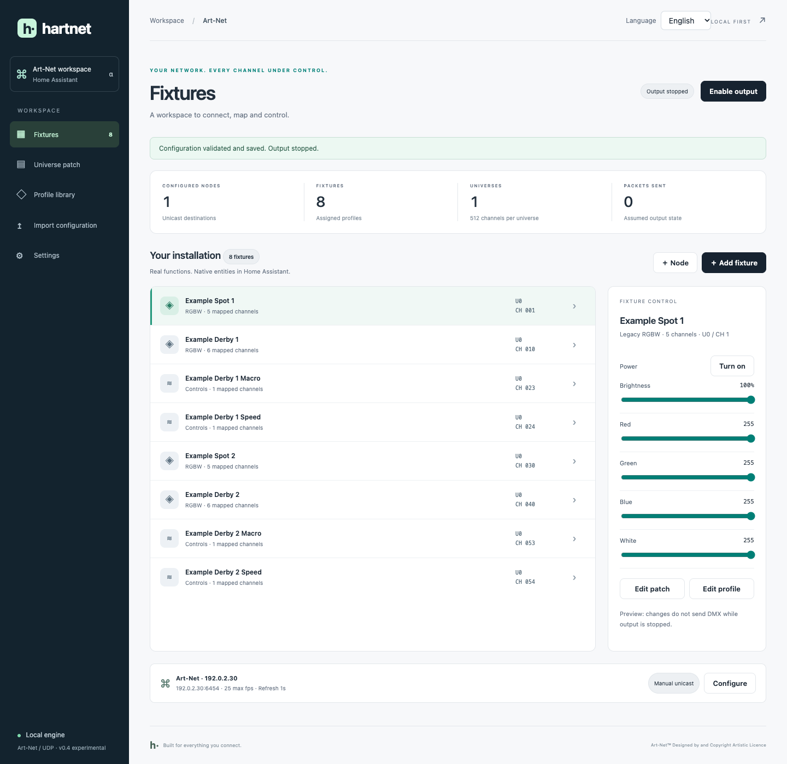

# HartNet

**Art-Net profiles, a visual workspace, and native Home Assistant entities.**

Status: **experimental alpha 0.4.0**. The engine, app and HA integration are implemented.
Physical gateway and fixture validation is ongoing. This is a subset of Art-Net functionality.



HartNet separates network nodes, reusable profiles and installed fixtures. With a documented
DMX mapping, it can control intensity, color, pan/tilt, speed, macros, relays and other values.
Function semantics come from each fixture's manual.

## Features

- Home Assistant OS app with authenticated Ingress access.
- English and Spanish interface, automatic browser-language selection and a saved language switch.
- Native `light`, `number`, `select` and `switch` entities, configured through the HA UI.
- Responsive fixture controls, a 512-channel patch, profile library and profile editor.
- Previewed import of an explicit subset of `ha-artnet-led` direct-mode configuration.
- 8/16/24/32-bit functions with adjacent or separate bytes and configurable byte order.
- Portable JSON profiles without installation IPs, universes or start addresses.
- Unicast output, per-node FPS limits, refresh and transitions for continuous values.
- ArtPoll / ArtPollReply discovery, including BindIndex, input/output subscriptions and expiry.
- Optional subscribed unicast with periodic targeted polls and controller announcements.
- Address, overlap, range and option validation; authenticated API and atomic project backups.
- Durable light/number/select/switch values and output intent, restored before the first DMX frame.
- Bounded network retries and a Supervisor health endpoint for process recovery.

**Values and output intent survive app restarts and process crashes.** Each accepted command is
saved atomically before its HTTP response. An active output resumes with its saved values;
a manual stop remains stopped. A fresh installation starts stopped. HA entities are unavailable
while output is stopped. No MQTT broker is required.
Changing the interface language never translates user-provided names or alters a patch.

## Install on Home Assistant OS

1. Add `https://github.com/NaturalDevCR/hartnet` to the Apps store repositories.
2. Install **HartNet**, set `api_token` to a random value of at least 16 characters, and open its UI.
3. Add this repository to HACS as an **Integration**, download HartNet, and restart HA.
   Alternatively, copy `custom_components/hartnet` to `/config/custom_components/hartnet`.
4. Add **HartNet** under Settings → Devices & services. Use host `127.0.0.1`, port `8099`,
   and the app's API token. Keep that token private.
5. Import your `light:` block or create nodes, profiles and fixtures. Review and save the patch.
6. Stop any previous sender controlling the same destination and universe before enabling output.

See [app installation details](apps/hartnet/DOCS.md). Supervisor/HACS installation checks
are documented separately from automated tests.

## Import from ha-artnet-led

The importer supports `artnet-direct`: nodes, ports, universes, FPS, refresh, full/partial frames,
RGB/RGBW/RGBWW/CCT layouts, dimmers, binary functions, constants, resolution and byte order.
Universes retain their original numbers, including universe 0.

**Convert standalone dimmers to number entities** makes speed and macro channels numeric.
Leave it unchecked when a dimmer must remain compatible with `light.turn_on` automations.
A macro becomes a `select` only after its documented values and labels are configured.

Unsupported functions (`xy`, hue/saturation, single-channel temperature, calculated RGB white),
other transports and destination overrides are rejected explicitly. Per-command transitions work;
legacy per-fixture default transitions are not imported yet. High-resolution color uses the whole
range, while the legacy component scales 8-bit steps. Constants preserve legacy scaling.
Existing entity IDs are neither adopted nor renamed; automation migration is a separate step.

## Restart recovery

Brightness, color, macro/speed values, switches and selections are saved with the project in one
versioned transaction. Fade targets are saved once per command; individual frames do not write
to storage. After an interrupted transition, the final requested value is restored immediately.

Enable **Start on boot** and **Watchdog** in the app settings for host reboot/process recovery.
The [Supervisor watchdog](https://contributors.home-assistant.io/apps/reference/configuration/#url-templates)
checks `/health`; the endpoint exposes no project details. Transient socket/destination errors
retry with bounded backoff without blocking the HTTP API or healthy destinations.

Version 0.2 saved no runtime values. The first upgrade to 0.3 therefore starts stopped; restore the
intended presets and enable output once. Subsequent restarts recover automatically. Invalid or
unsupported stored state fails closed instead of transmitting invented defaults. Keep backups.

## Art-Net subscriptions (0.4)

Each node's **Output mode** defaults to **Manual unicast**, preserving existing behavior. Choose
**Subscribed unicast** to send a universe only while that configured IP advertises it in ArtPollReply.
HartNet sends targeted ArtPoll every 2.75 seconds while output is enabled, requests change
notifications, and expires replies after 5.75 seconds (one interval plus a three-second response
window). Missing subscriptions show **Waiting for subscriptions**; they are not a physical-state check.

Input and output subscriptions are combined across BindIndex records. Disabled inputs, sACN ports
and non-DMX ports are excluded. A withdrawn or expired subscription stops that universe; its
reappearance sends a fresh frame even when periodic refresh is disabled. Other destinations continue.
Discovery never adds or redirects output destinations. Subscriptions are learned again after restart;
the first transmitted frame still uses the saved runtime values.

While subscribed output is enabled, HartNet answers untargeted ArtPoll with delayed unicast
ArtPollReply as a controller with no physical DMX ports, and announces itself locally when polling.
Announcements currently use `OemUnknown` (`0x00ff`); an assigned product OEM code and broader
hardware/conformance validation remain release work. Stopping output stops polling and announcements
as well as DMX. Explicit discovery remains available with output stopped and waits up to three seconds.

## Profiles and devices

Profiles describe functions with relative slots ordered most-significant byte first. For example,
`slots: [1, 8]` is a 16-bit value with coarse at slot 1 and fine at slot 8.

`number`, `select` and `switch` create separate controls in the HA device. Color and dimmer
functions form a light; `constant` holds a fixed value. Select functions use explicit representative
values; conditional ranges, advanced wheels and full professional fixture formats remain future work.

Editing a shared profile affects every fixture using it. New entities appear on the next poll.
Reload the HA integration after changing types, removing controls or editing existing profile
metadata. Obsolete registry entries become unavailable and are not automatically deleted.

## Development

The engine/app require Python 3.13+. Integration tests use **HA 2026.10.2 / Python 3.14**.

```sh
uv venv --python 3.13
uv pip install --python .venv/bin/python -e '.[test]'
.venv/bin/pytest -q
.venv/bin/ruff check apps custom_components tests scripts
.venv/bin/python -m hartnet --dev --data data/project.json
```

Open `http://127.0.0.1:8099`. Development authentication bypass is restricted to loopback.
The bundled sample uses documentation-only address `192.0.2.30`.

```sh
uv venv .venv-ha --python 3.14
uv pip install --python .venv-ha/bin/python -e . pytest-homeassistant-custom-component==0.13.373
.venv-ha/bin/pytest tests/test_homeassistant.py -q
docker build -t hartnet:dev apps/hartnet
```

`scripts/check_ui.py` uses Playwright and locally installed Chrome on macOS. It checks both
languages, persistence, imports, patch, controls, profile editing and 1440/390/320px layouts.
It never enables DMX. Network tests are restricted to loopback.

## Limits and roadmap

The sender supports manual unicast and optional subscription-aware unicast to explicitly configured
nodes. It remains a subset of Art-Net 4, without full network-wide controller management. RDM,
ArtDataRequest, DMX input/merge, ArtSync, ArtTrigger, timecode, sACN, KiNet, OFL/GDTF imports and
a community library are not implemented. Fixture functions require documented profiles.

Unassigned slots are sent as zero. Stopping output stops packets; a gateway may hold the last
state. Turning a light off does not reset its independent numbers, selectors or relays. Define
resting values explicitly. ArtDmx does not acknowledge physical fixture state.

See the [architecture](docs/architecture.md) and [validation record](docs/validation.md).

## Attribution

Protocol reference: [official Art-Net specification](https://art-net.org.uk/downloads/art-net.pdf).

**Art-Net™ Designed by and Copyright Artistic Licence**.

Original code: [MIT](LICENSE). Third-party profiles retain their attribution and licenses.
