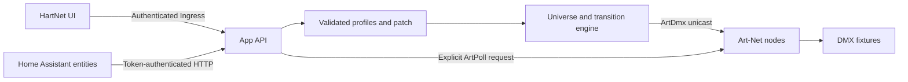

# Architecture

The initial target is Home Assistant OS. The app runs the engine and interface; the native
integration turns profile functions into devices and entities.

## App and integration

| Approach | Benefits | Costs |
| --- | --- | --- |
| Integration with panel | One installation, native authentication/API | Engine and fades share HA's lifecycle |
| App with MQTT | Independent engine, HA OS distribution | Extra broker and discovery representation limits |
| App with integration | Independent engine, Ingress UI and semantic entities | Two separately installed components |

HartNet uses the third option. This also allows running the app beside HA Container in the future.
Custom HA panels can provide a modern UI; the engine lifecycle motivates this separation.

References: [apps](https://developers.home-assistant.io/docs/apps),
[Ingress](https://developers.home-assistant.io/docs/apps/presentation/),
[config entries](https://developers.home-assistant.io/docs/config_entries_index/),
[custom panels](https://contributors.home-assistant.io/frontend/custom-ui/panel/).

## Model

- **Node:** unicast endpoint and transmission settings; not necessarily a physical fixture.
- **Profile:** reusable and exportable functions with relative offsets.
- **Fixture:** persistent ID, name, node, universe and start channel.
- **Control:** kind, ordered MSB→LSB slots, limits, default and explicit values.
- **Light:** grouped intensity/color representation inside a fixture.
- **Output universe:** one composed buffer per destination and universe.

Separate slots support mappings such as `pan=[1,8]`. Documented macros can use selects;
continuous or unknown values use numbers. Fan, cover, valve, button, sensor and event domains
need additional semantic adapters and state contracts before being advertised.

Values are DMX integers. Physical scales, conditional ranges, matrices and advanced wheels
remain future extensions.

## State and network

ArtDmx is UDP without physical acknowledgement. The UI reports active/stopped output and
assumed state. Sending bytes does not establish that a node is online.

One UDP socket uses local port 6454, with bounded transmission frequency. Explicit discovery
shares the socket and identifies replies by IP and BindIndex, recording last observation. Cached
replies expire using monotonic time after 5.75 seconds. The UI observation time uses wall-clock time.

Each node defaults to manual output. Subscribed output polls the configured endpoint using targeted
ArtPoll every 2.75 seconds while the sender runs. It accepts DMX input/output subscriptions across
bindings, excluding disabled inputs and ports using sACN or another protocol. Both advertised and
source IP must match the configured destination before a subscription can enable output. Discovery
cannot change routing. Lost subscriptions invalidate the cached frame; renewed subscriptions send
immediately even with refresh disabled. Subscriptions are never persisted.

A subscribed sender answers untargeted ArtPoll after a random delay of up to one second, using a
unicast ArtPollReply with StController and no physical DMX ports. A targeted poll cannot match this
controller, which has no DMX input/output subscriptions. Poll cycles also send an announcement to
the controller's own local address. Delayed replies are bounded/coalesced and cancelled on stop.
Manual mode sends no automatic management traffic. This does not implement network-wide dynamic
routing, all Art-Net management packets, or full Art-Net 4 conformance.

Project edits require stopped output. A single versioned envelope stores the validated project,
all accepted fixture targets and output intent. Temporary-file write, file fsync, atomic replacement
and directory fsync precede acknowledgement and publication to the sender. Disk IO runs outside
the event loop; the API serializes mutations. Per-frame fades do not write to storage.

Startup validates the whole document before restoring any state or creating a sender task. Legacy
project-only files migrate without inventing runtime values. Invalid/unsupported state fails closed.
Normal shutdown stops sockets without persisting a user stop; only the explicit output API changes
that intent. Restart restores the target of an interrupted fade before the first frame. A manual stop
survives restart. Unchanged fixture mappings retain presets during unrelated project edits.

Network failures retry with bounded exponential backoff. Synchronous destination failures do not
block healthy destinations. Unexpected task failures make `/health` return 503 so the Supervisor
watchdog can restart the process. Expected network recovery keeps HTTP/API available. UDP still
does not acknowledge physical state.

## Languages and exports

The UI defaults to English, selects Spanish for a Spanish browser, and stores an explicit choice
in local browser storage. Only interface strings are translated. User-provided names, enum labels,
profile content and technical protocol identifiers retain their original values. The Spanish catalog
is `static/es.json`; repository documentation and default diagnostic messages use English.

`hartnet-profiles` version 1 includes only relative profiles, without node addresses, universes,
start channels, tokens or HA data. Full project backup is a separate action. Imports validate
versions and reject conflicting profile IDs.

A future community library must preserve provenance, attribution, review/versioning and source
licenses. OFL/GDTF need explicit adapters; their collections are not redistributed here.
