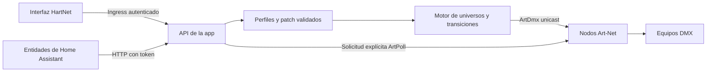

# Arquitectura

El destino inicial es Home Assistant OS. La app ejecuta el motor y la interfaz;
la integración transforma sus funciones en dispositivos y entidades nativas.

## Por qué app más integración

| Opción | Ventajas | Costes |
| --- | --- | --- |
| Solo integración con panel | Una instalación, autenticación/API nativa | Motor y fades comparten ciclo de vida con HA |
| Solo app con MQTT | Motor independiente, distribución HA OS | Broker adicional y limitaciones de representación por descubrimiento |
| App más integración | Motor independiente, UI Ingress y entidades semánticas | Instalar y versionar dos piezas |

Se elige la tercera para el alcance solicitado. La separación también permite ejecutar
la misma app junto a HA Container en el futuro. Un panel personalizado puede ofrecer una
UI moderna sin app; la elección se debe al ciclo de vida del motor, no a una limitación
visual de Home Assistant.

Referencias: [apps](https://developers.home-assistant.io/docs/apps),
[Ingress](https://developers.home-assistant.io/docs/apps/presentation/),
[config entries](https://developers.home-assistant.io/docs/config_entries_index/),
[paneles personalizados](https://contributors.home-assistant.io/frontend/custom-ui/panel/).

## Modelo

- **Nodo:** endpoint unicast y parámetros de transmisión. No implica un fixture físico.
- **Perfil:** funciones y offsets relativos, reutilizable y exportable.
- **Equipo instalado:** instancia con ID persistente, nombre, nodo, universo y canal inicial.
- **Control:** tipo, slots ordenados MSB→LSB, límites, default y valores explícitos.
- **Luz:** representación agrupada de intensidad/color dentro de un equipo.
- **Universo de salida:** un buffer compartido por destino y universo. No se generan
  emisores independientes que sobrescriban otros controles del mismo universo.

Los slots separados permiten `pan=[1,8]`. Macros documentados se representan con select;
valores continuos o desconocidos con number. Fan, cover, valve, button, sensor y event
requieren adaptadores semánticos y contratos de estado adicionales antes de anunciarse.

La versión inicial usa valores DMX enteros. Escalas físicas, rangos con funciones
condicionales, matrices y ruedas avanzadas son extensiones pendientes del formato.

## Estado y red

ArtDmx es UDP sin acuse físico. La UI informa salida activa/detenida y estado asumido;
no presenta un nodo configurado como «online» por el simple hecho de haber enviado bytes.
El estado de los canales es el deseado, no una medida del aparato.

La app conserva un socket UDP y limita la frecuencia por universo/nodo. El puerto local
es 6454. El descubrimiento se solicita expresamente y usa el mismo socket. Las respuestas
se identifican por IP y BindIndex y se muestran con el instante de última observación.
Todavía no hay caducidad periódica ni mantenimiento de suscripciones Art-Net 4.

La configuración se modifica con salida detenida. Se valida antes de guardar y se escribe
mediante archivo temporal, fsync y reemplazo atómico. Se conserva la versión anterior.
La identidad de la instalación sobrevive al importar otro patch. Los valores de ejecución
son volátiles; cada arranque requiere activar explícitamente el emisor.

## Exportación

`hartnet-profiles` versión 1 contiene solo perfiles con offsets relativos. No contiene
nodos, universo, canal inicial, token ni datos de HA. Un backup completo de proyecto sí
incluye direcciones y se ofrece como acción separada. La importación valida versiones y
rechaza IDs de perfil existentes cuyo contenido sea distinto.

Una biblioteca comunitaria posterior debe conservar procedencia y atribución, soportar
revisión/versionado y respetar las licencias de las fuentes. OFL/GDTF necesitan adaptadores
explícitos; no se redistribuyen sus colecciones en este repositorio.
